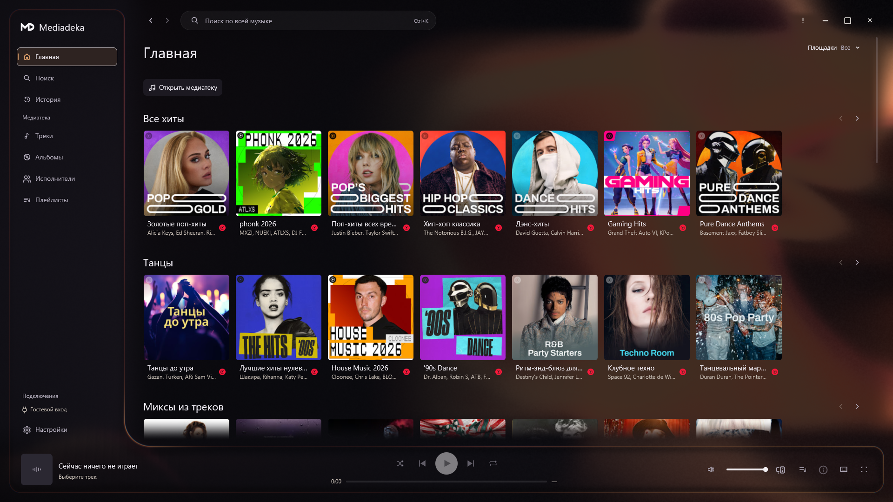

# Mediadeka

Mediadeka — музыкальный плеер для Windows x64. Слушайте музыку с компьютера, домашнего сервера Jellyfin и подключённых сервисов через общую медиатеку, поиск и очередь.

[Выпуски для Windows](https://github.com/starsinc1708/mediadeka/releases) · [Roadmap](ROADMAP.md) · [Как внести вклад](#как-внести-вклад)



Главная страница в гостевом режиме с общедоступными подборками YouTube Music.

## Возможности

- Локальные файлы и подключения Spotify, YouTube Music, Яндекс Музыка, SoundCloud и Jellyfin. Доступность поиска и воспроизведения зависит от источника.
- Общая очередь, плейлисты, история и избранное. Гостевой режим позволяет открыть локальную музыку без входа в сервис.
- Синхронные тексты с подсветкой слов, когда доступна пословная разметка. Нажатие на строку переводит плеер к этой части песни.
- Интерфейс Fluid Glass, полноэкранный плеер, клавиатурное управление, повышенный контраст и уменьшенное движение.

## Как запустить

1. Скачайте ZIP для Windows x64 со [страницы выпусков](https://github.com/starsinc1708/mediadeka/releases), сверьте его SHA-256 по `SHA256SUMS.txt` и распакуйте.
2. Извлеките `libmpv-2.dll` и положите её рядом с `mediadeka.exe`. [Проверенный пакет libmpv для Windows x64](https://github.com/zhongfly/mpv-winbuild/releases/download/2026-11-19-b7339522cd/mpv-dev-lgpl-x86_64-20261119-git-b7339522cd.7z)
3. Запустите `mediadeka.exe`. Для знакомства с плеером выберите «Гостевой вход».

SHA-256 проверенной `libmpv-2.dll` — `88c13c8a806195706918fc1c5ecfbcd466e3590a527f567bf479ccd081903dd0`. Для входа в SoundCloud через встроенное окно нужен Microsoft Edge WebView2 Runtime.

Первый выпуск рассчитан на Windows x64. [Планы для Linux, macOS, Android и Android TV](ROADMAP.md#выпуски-на-других-платформах)

## Сборка на Windows

Mediadeka написана на Rust с GPUI. Для сборки понадобятся Git, PowerShell 7, Rust `1.100.0` с целью `x86_64-pc-windows-msvc`, Visual Studio Build Tools с компонентами C++ и Windows SDK.

```powershell
rustup toolchain install 1.100.0 --profile minimal --component rustfmt --component clippy
rustup target add --toolchain 1.100.0 x86_64-pc-windows-msvc
rustup override set 1.100.0
Push-Location app2
cargo build --locked --features fluid-glass-default
Pop-Location
```

Положите Windows x64 `libmpv-2.dll` рядом с `app2/target/debug/mediadeka.exe` для воспроизведения.

Профиль по умолчанию хранится в `%LOCALAPPDATA%/Mediadeka/app2/`. Для проверки на новом профиле задайте `MEDIADEKA_PROFILE_DIR` в текущем процессе.

## Пакет сборки

```powershell
pwsh -File scripts/Build-Release.ps1
```

Скрипт компилирует оптимизированную сборку с `--locked` и `fluid-glass-default`. В `dist/` появляются ZIP с EXE и контрольные суммы. DLL поставляется отдельно. Файл `build-info.json` внутри ZIP указывает исходный коммит, версию Rust и SHA-256 исполняемого файла.

## Как внести вклад

Опишите сценарий в GitHub Issues или приложите его к pull request. Команды проверки запускаются из `app2/`.

```powershell
cargo fmt --all -- --check
cargo clippy --locked --features capture --all-targets -- -D warnings
cargo test --locked --features capture --lib
```
